<div align="center">

# Reinforcement Learning AI Racing Game

**An AI that teaches itself to race, from random crashes to a 51-second lap, with nothing but trial, error and a reward signal.**


<a href="docs/media/demo.mp4">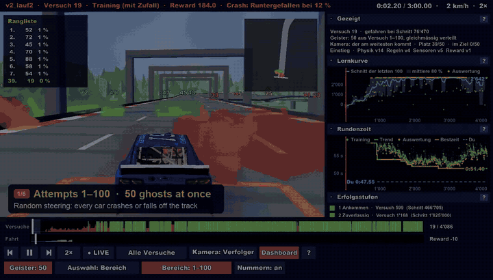</a>

▶️ **[Watch the full 1-minute demo video](docs/media/demo.mp4)** (50 ghosts per learning stage, best lap with sensors, dashboard tour)

</div>

---

## What is this?

A small low-poly 3D racing game written in Python, built as a playground for **reinforcement learning (RL)**.
Nobody tells the AI how to drive. It never sees a racing line, a map or its own coordinates.
It only feels what a driver would feel: distances to the track edge, its speed and its angle to the road.
It gets one simple score: **points for new track covered, a small penalty for every tick of time, a penalty for crashing, a bonus for finishing.**

Everything else, like braking before a hairpin, drifting through a curve or taking a jump at the right speed, it has to discover by itself.

| | |
|---|---|
| 🏁 **Track** | "Einstieg": 2.9 km, floating track without walls, jumps, banked curves |
| 🧠 **Algorithm** | Soft Actor-Critic (SAC), two small neural networks (actor + critic) |
| 👀 **Input** | 24 numbers: 17 distance rays, speed, angle, slip, steering, slope, airborne, vertical speed |
| 🎮 **Output** | 4 numbers: steering, throttle, brake, drift (exactly the same controls a human has) |
| ⏱️ **Result** | First valid lap after **599 attempts**, best lap **0:51.40** after ~3,000 attempts (human record: 0:47.55) |

> 🚧 **Work in progress:** the reward function is not fully tuned yet. You can see this in the [lap-time curve](#the-numbers): after about 3,000 attempts the AI stops improving and stays at roughly the same lap time, instead of continuing to get faster. With a reworked reward, I'm confident the AI will beat my own best lap of 0:47.55.

---

## Watch it learn

Every single attempt is recorded. The viewer can replay up to 100 attempts at once as transparent **ghosts**.
The demo video takes 50 ghosts from each stage of training (run `v2_lauf2`, 4,086 attempts in total):

| Attempts 1–100 | Attempts 600–1,500 | Attempts 1,500–4,086 |
|:---:|:---:|:---:|
| 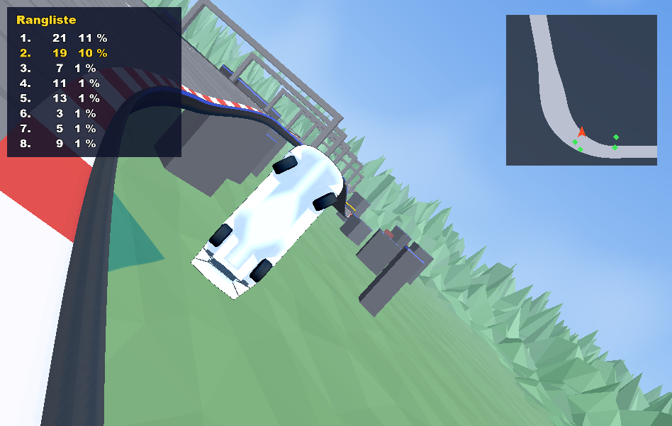 | 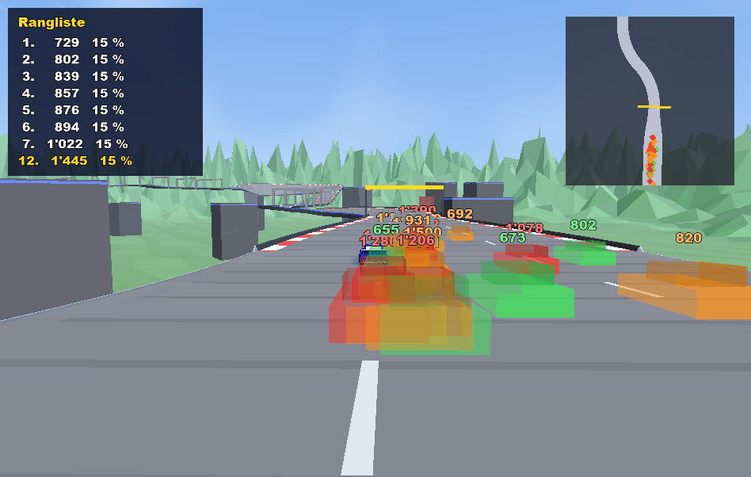 | 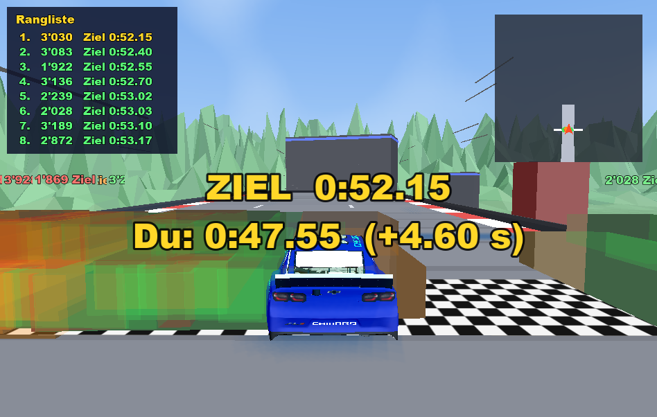 |
| Random steering. Every car falls off the track within the first few hundred meters. | The cars stick to the road. The first ones make it all the way to the finish. | Almost every ghost finishes, and they bunch up within a second of each other. |

<details>
<summary><b>What happens in each stage</b> (click to expand)</summary>

1. **Attempts 1–100: pure exploration.** The network starts with random weights. SAC adds noise to every action on purpose, so the car wiggles, accelerates and drives off the edge. Each crash still teaches the critic something like: "near the edge with this speed and this angle, things end badly".
2. **Attempts 100–600: surviving.** The AI learns to keep the car on the road and to follow the first curves. The progress reward pulls it further each time, but a few tricky sections stop every attempt (see the clusters at ~15%, ~35% and ~50% in the chart below).
3. **Attempt 599: the first valid lap.** One lucky, noisy attempt crosses the finish. From here on, the finish bonus is in the replay buffer, and success spreads quickly: by attempt ~1,000 more than half of all attempts finish.
4. **Attempts 1,500–4,086: getting fast.** Now the time penalty starts to matter. Every 1/60 s costs points, so shorter laps score higher. The AI learns to brake later, cut curves tighter and drift. The official best time falls from 61.0 s to **51.4 s**.

</details>

### The numbers

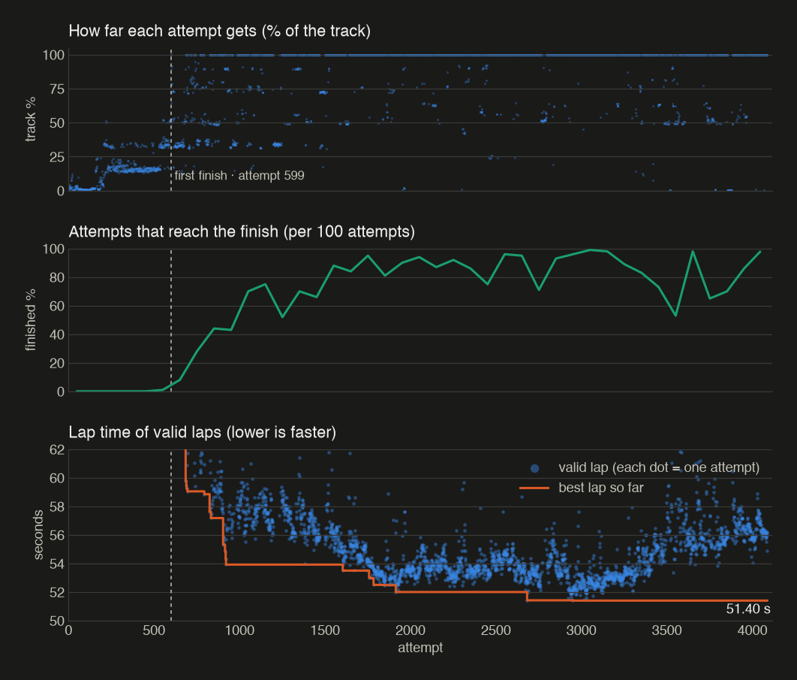

*Top: how far each attempt got. Middle: share of attempts that finished. Bottom: lap time of every valid lap, and the best lap so far. Laps get a bit slower near the end because the policy started to drift. This is a known SAC effect, and it is one reason the best model is saved separately.*

---

## How reinforcement learning works here

### The loop

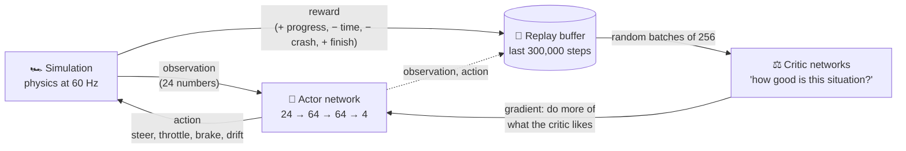

60 times per second, the **actor** looks at the 24 numbers and chooses an action.
The simulation moves the car 1/60 s forward and returns a **reward**.
Every step is stored in the **replay buffer**.
In the background, the **critic** learns to predict "how much reward will I collect from here on?".
The actor learns to choose the actions that the critic rates highest.

That's the whole idea. After some millions of steps, the actor's 4 outputs have turned into a driving style.

### 1. What the AI sees (observation)

The AI only gets what a driver in the car could perceive (rule R5). It gets **no coordinates, no map and no racing line**:

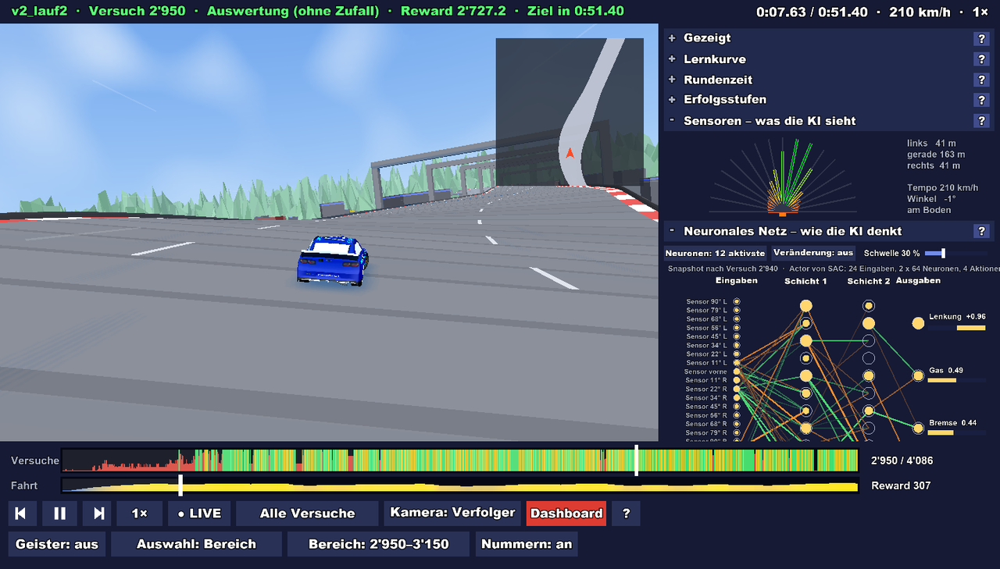

| Index | Input | Meaning |
|---|---|---|
| 0–16 | 17 distance rays | Distance to the track edge from −90° (left) to +90° (right), up to 200 m, scaled 0…1 |
| 17 | speed | forward speed / 110 m/s |
| 18 | angle to track | angle between car heading and road direction |
| 19 | slip | sideways speed (the car is sliding) |
| 20 | steering | current steering wheel position |
| 21 | slope | pitch of the car (uphill / downhill) |
| 22 | airborne | 1 if no wheel touches the ground |
| 23 | vertical speed | rising / falling speed (for jumps) |

### 2. What the AI can do (action)

Four continuous values, **exactly the same controls as a human player** (rule R4):
steering −1…1, throttle 0…1, brake 0…1, drift 0…1.
The AI has no extra grip, no higher top speed and no resets (rule R3).

### 3. What the AI wants (reward)

The reward is the only thing that tells the AI what "good" means. It is deliberately minimal (rule R7):

| Component | Value | Why |
|---|---|---|
| **Progress** | +1 per meter of *new* best progress along the track | Drive forward. Only new records count, so driving back and forth earns nothing. |
| **Time** | −0.1 per physics step (−6 per second) | Be fast. A 45 s lap costs 270 points, a 55 s lap costs 330. |
| **Crash** | −50 once | Falling off or getting stuck is bad, but not so bad that the AI stops taking risks. |
| **Finish** | +100 once | A valid lap (all checkpoints in order) is much better than "almost". |

There is **no reward for speed itself**, no reward for "staying in the middle" and no hand-made hints.
A full lap is worth about +2,700 points. The rest is up to the AI.

> 💡 **Lesson learned:** a "smarter" reward with a bonus that grows with lap time (v2) looked better on paper but made training unstable (runs `v2_lauf3`–`v2_lauf5`). The simple reward won.

### 4. How it learns: Soft Actor-Critic

| Concept | In plain words |
|---|---|
| **Actor** | The driver. A neural network (2 hidden layers) that maps the 24 inputs to the 4 controls. |
| **Critic** | The coach. Two networks that estimate how much future reward a situation and action will bring. The actor is trained to maximize the critic's estimate. |
| **Replay buffer** | Memory of the last 300,000 steps. Learning samples random batches from it, so a rare success (the first finish!) is replayed many times. |
| **Entropy ("soft")** | SAC is rewarded for staying a bit random. That keeps it exploring instead of settling on the first thing that works. |
| **γ = 0.995** | How far ahead the AI cares: about 200 steps, so ≈ 3.3 seconds. This is far enough to brake before a curve. |
| **Evaluation** | Every 25,000 steps the current network drives one lap *without* randomness. Only these deterministic laps count as official times (rule R6). |

### 5. Fair play: the rules

The project has strict rules ([CLAUDE.md](CLAUDE.md)) so that the AI's lap times mean something:

- **Same physics, same car, same controls** as the human player (R3, R4).
- **Driver's view only:** no coordinates, no track knowledge beyond 200 m (R5).
- **Time = physics steps × 1/60 s,** never wall-clock time. Official times come only from deterministic runs (R6).
- **Valid lap:** standing start, all checkpoints in order, then the finish line. No shortcuts (R1).
- **Crash** = fell off the track, no progress for 2 s, or 15 m backwards. **Time limit** is 180 s (R2, R11).
- **Everything is versioned:** physics, rules, sensors, reward and track. Runs with different versions are never compared (R8, R9).

---

## The dashboard

`viewer.py` is a video player for the training. It shows any attempt (or 100 at once) together with a live dashboard on the right. It only reads recordings, so it can run *while* training without slowing it down.

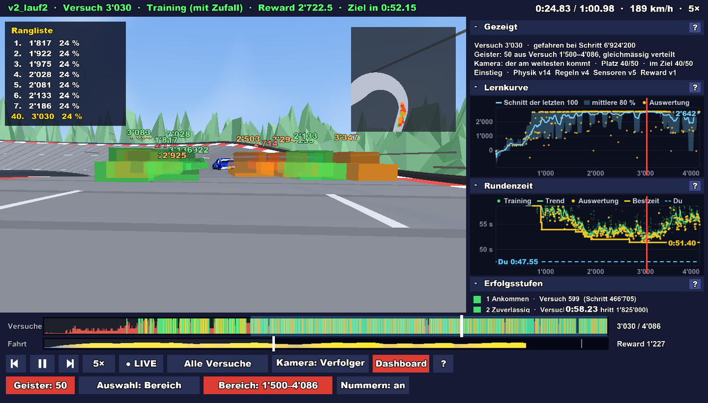

| | |
|:---:|:---:|
| 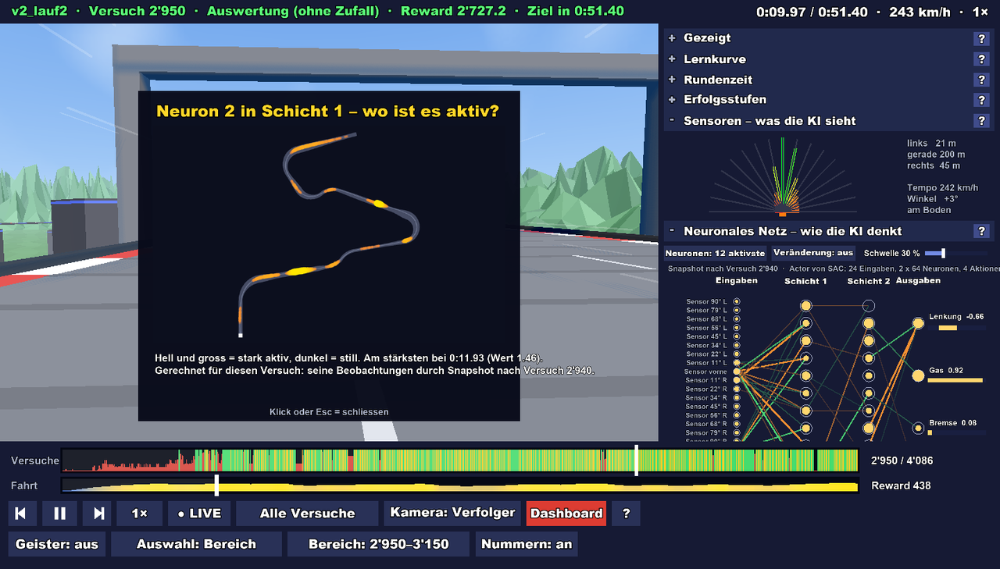 | 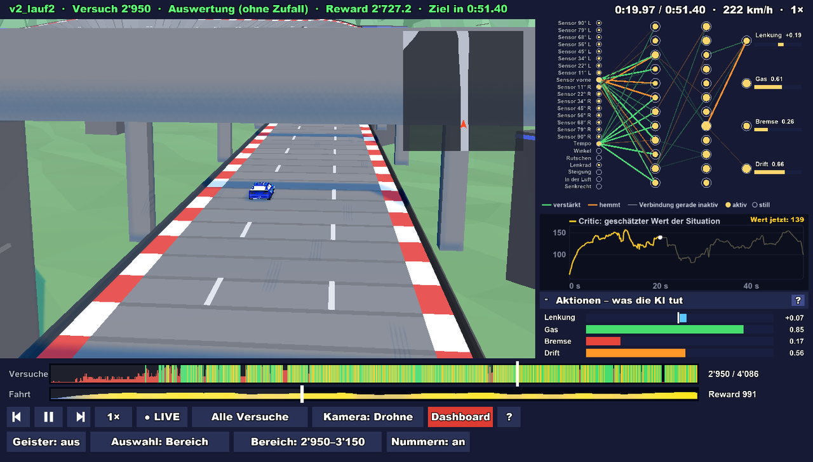 |
| **Click on a neuron** to see where on the track it is most active (here: neuron 2 of layer 1). | **Actions, critic and drone camera.** You can see what the AI does and how much reward it expects from the current spot. |

**Features**

- 📊 **Learning curve and lap times.** Click any point to jump to that attempt.
- 🏆 **Success stages:** first lap → reliable (5 evaluations in a row) → plateau → faster than me.
- 📡 **Sensors:** the 17 rays as the AI sees them, live.
- 🧠 **Neural network, live:** every neuron's activation and every active connection (green = excites, orange = inhibits). You can also switch to *"show change"*, which highlights the weights that changed most since the last snapshot.
- 📉 **Critic:** how good the AI thinks the current situation is, plotted along the whole lap.
- 🎮 **Actions:** steering, throttle, brake and drift as bars.
- 💰 **Reward breakdown** of the current run, plus statistics.
- 👻 **Ghosts:** 1–100 attempts at once, chosen from a range, the last N attempts, or milestones. Includes a live ranking and a minimap.
- 🎥 **Cameras:** chase, drone (cinematic), top-down and free flight. Speed from 0.5× to 50×.
- ❓ Every card has a **"?"** that explains it in plain language.

> The UI text is in German (the project started as "KI-Fahrschule", *AI driving school*).

---

## Getting started

Tested on macOS (Apple Silicon) with Python 3.13.

```bash
git clone https://github.com/joaquin4053/Reinforced-learning-ai-racing-game.git
cd Reinforced-learning-ai-racing-game
python3 -m venv .venv
.venv/bin/pip install -r requirements.txt
```

### 🎮 Drive yourself

```bash
.venv/bin/python play.py                       # track 1 ("Einstieg")
.venv/bin/python play.py tracks/poly03.json    # other tracks: poly02 (hills), poly03 (jumps)
```

**Keyboard:** W/S or arrow keys = throttle/brake, A/D = steer, Space = drift, R = restart, C = camera, V = AI sensors.
**Gamepad:** left stick = steer, RT = throttle, LT = brake, X/RB = drift.

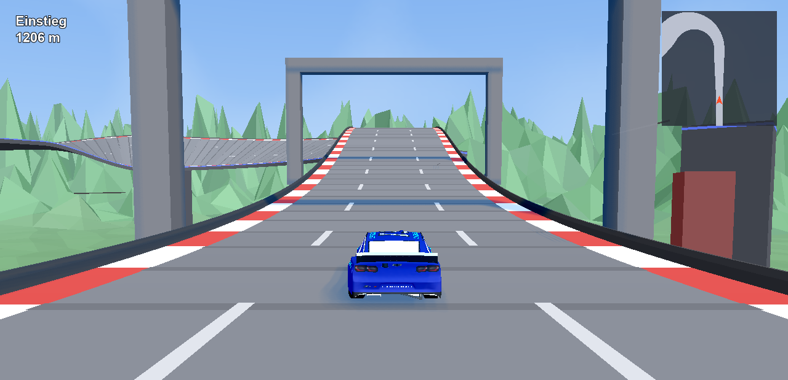

### 🤖 Watch the trained AI drive

A trained model is included (`pretrained/v3_lauf1`, 256×256 network, official best lap **0:52.38**). The network drives live, right now, without any randomness:

```bash
.venv/bin/python watch.py pretrained/v3_lauf1 --modell pretrained/v3_lauf1/best_model.zip
```

### 🏋️ Train your own

```bash
.venv/bin/python train.py --name my_run                  # runs until Ctrl+C, resumable
.venv/bin/python viewer.py my_run --geister 50           # watch the last 50 attempts as ghosts (works during training)
.venv/bin/python viewer.py my_run --geister 50 --von 1 --bis 100   # 50 ghosts from attempts 1–100
.venv/bin/python watch.py my_run --live                  # the newest network drives live
.venv/bin/python -m pytest                               # 64 tests (determinism, rules, sensors, recording …)
```

Training settings are in [`train_config.toml`](train_config.toml), the reward is in [`reward_config.toml`](reward_config.toml), and physics and sensors are in [`config.toml`](config.toml).
With the default settings on an Apple M-series laptop, `v3_lauf1` drove its first valid lap after about 9 minutes. Training uses all CPU cores, and the Mac is kept awake automatically.

---

## Results

| Run | Network | Sensors | Attempts | First valid lap | Official best lap |
|---|---|---|---:|---:|---:|
| `v2_lauf2` (video) | 64 × 64 | 100 m | 4,086 | attempt 599 | **0:51.40** |
| `v3_lauf1` (included) | 256 × 256 | 200 m | 1,529 | attempt 978 | 0:52.38 (after only 24 min) |
| Human (me) | – | eyes 👀 | – | – | **0:47.55** |

Stage 4, *"faster than me"*, is still open. 🏁

---

## Project structure

```
game/        Simulation without graphics (also used for training): physics, rules, sensors, track, ghosts
render/      3D view, cameras, HUD, dashboard, neural-network panel. Draws only, never computes physics.
rl/          Gymnasium environment, reward, SAC training, recording, playback
tracks/      Tracks as JSON (center line built from pieces, checkpoints)
tools/       Helpers: storage check, cleanup, preview shots, reward example
tests/       pytest suite
pretrained/  A trained model to watch right away
docs/        Media for this README and the original German README
play.py · train.py · watch.py · viewer.py
```

<details>
<summary><b>Design decisions</b></summary>

- **Simulation and rendering are fully separate.** Training runs headless at ~1,500 steps per second, while the 3D view only replays recorded poses.
- **Deterministic physics** with a fixed 1/60 s step and 4 sub-steps. The same inputs always give the same lap, and tests check this.
- **Everything is recorded:** every attempt (observations, actions, rewards, poses) and network snapshots every 20 attempts. The viewer can therefore show the network's activations for any past attempt.
- **Versioned everything:** each run stores its config, seed, git commit and all version numbers, so results stay reproducible.

</details>

---

## Credits

- 3D car model: *"2020 NASCAR Chevrolet Camaro Zl1 1LE"* by [Ddiaz Design](https://sketchfab.com/ddiaz-design), [CC-BY-4.0](http://creativecommons.org/licenses/by/4.0/). See [CREDITS.md](CREDITS.md).
- Built with [Ursina](https://www.ursinaengine.org/) / Panda3D, [Gymnasium](https://gymnasium.farama.org/), [Stable-Baselines3](https://stable-baselines3.readthedocs.io/) and [PyTorch](https://pytorch.org/).
- 🇩🇪 The original, more detailed German documentation: [docs/README.de.md](docs/README.de.md).
